# Nexora

**Десятки инструментов. Одно место. Один жест.**

Надоело открывать десятки окон ради простых задач? Nexora объединяет музыку, AI, системное управление, быстрые инструменты и многое другое в компактном интерактивном острове прямо на рабочем столе Windows.

AI и умный чат. VPN и обход блокировок одной кнопкой. Музыка из разных источников. Управление Windows. Работа с текстом. Буфер обмена. Скриншоты и OCR. QR-коды. Заметки, таймеры, напоминания, погода и многое другое.

## Скриншоты

<table>
<tr>
<td align="center" width="50%"> Свёрнутый остров</td>
<td align="center" width="50%"> Свёрнутый остров, играет музыка</td>
</tr>
<tr>
<td align="center" width="50%">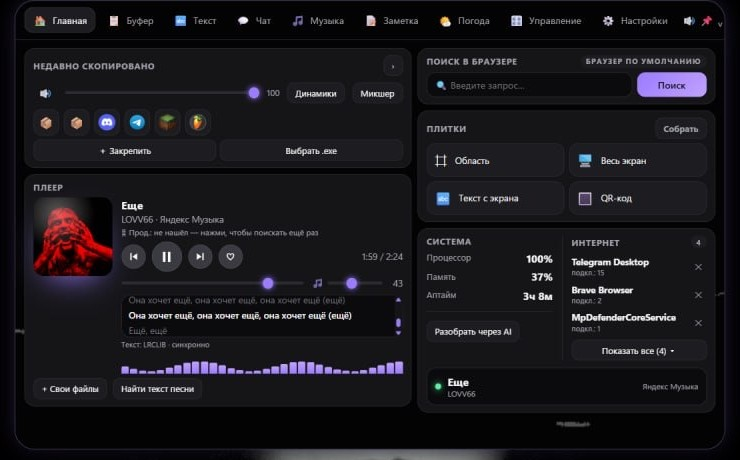 Главная: плеер, текст песни, спектр</td>
<td align="center" width="50%">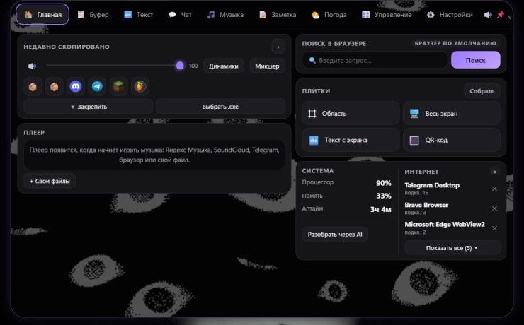 Главная: плитки, закреплённые приложения, система</td>
</tr>
<tr>
<td align="center" width="50%">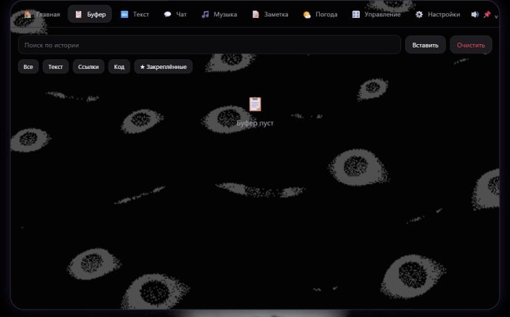 Буфер обмена</td>
<td align="center" width="50%">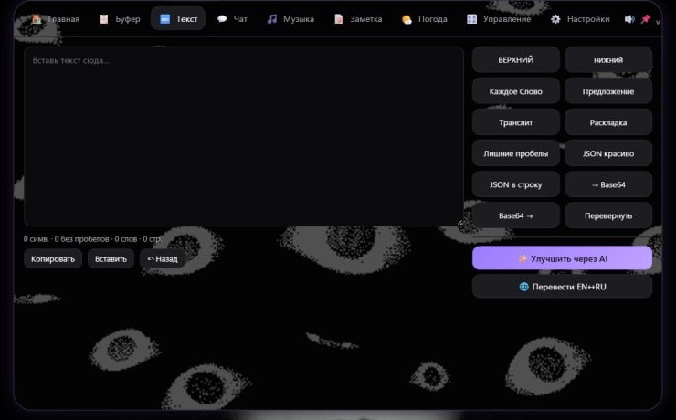 Работа с текстом</td>
</tr>
<tr>
<td align="center" width="50%">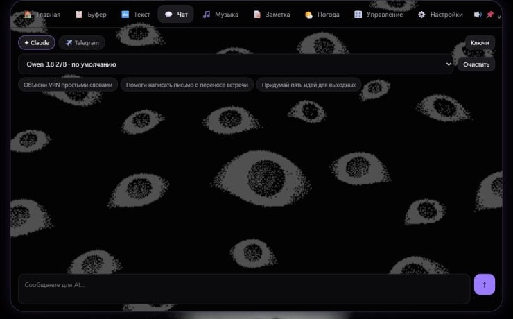 AI-чат</td>
<td align="center" width="50%">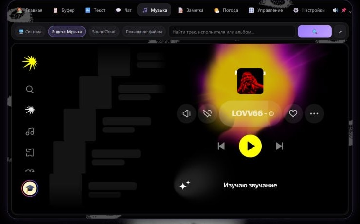 Яндекс Музыка</td>
</tr>
<tr>
<td align="center" width="50%">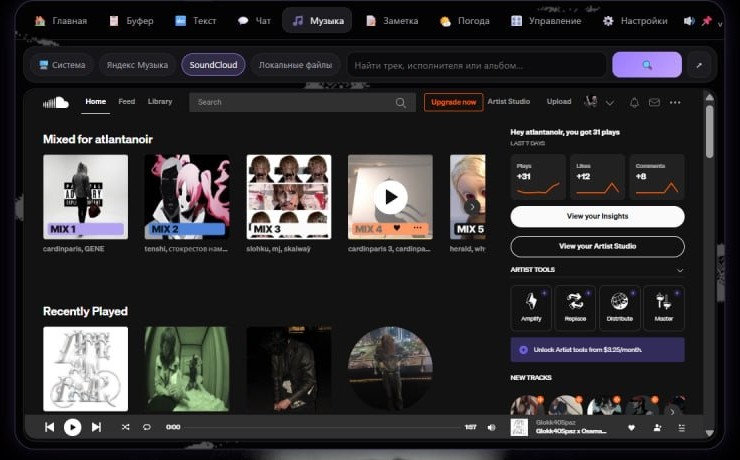 SoundCloud</td>
<td align="center" width="50%">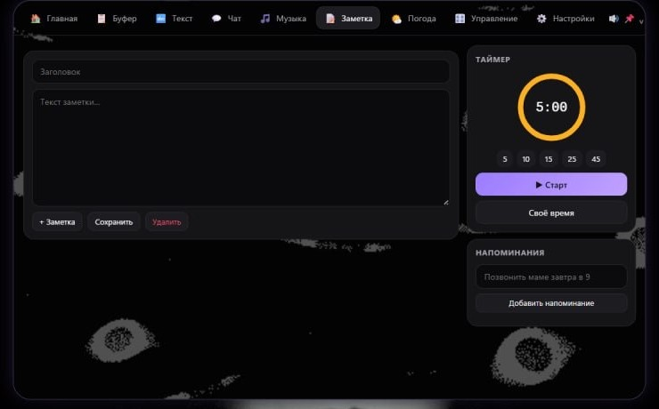 Заметки, таймер, напоминания</td>
</tr>
<tr>
<td align="center" width="50%">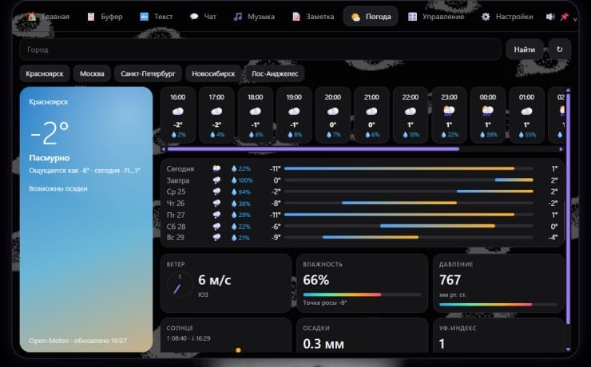 Погода</td>
<td align="center" width="50%">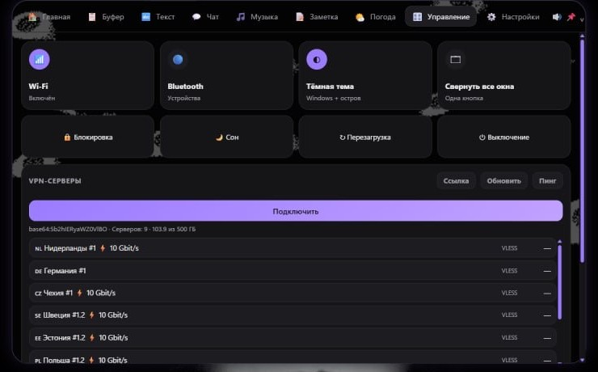 Управление Windows и VPN</td>
</tr>
<tr>
<td align="center" width="50%">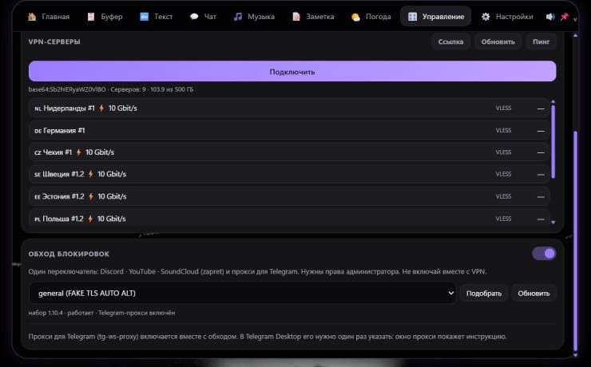 Обход блокировок</td>
<td align="center" width="50%">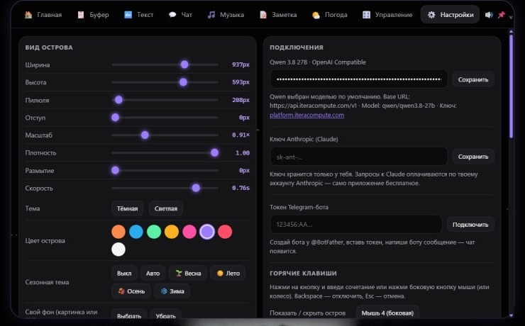 Настройки: внешний вид</td>
</tr>
<tr>
<td align="center" width="50%">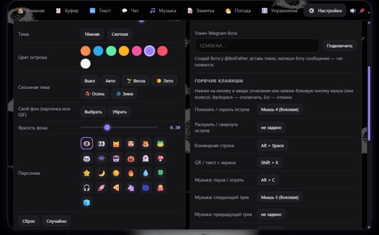 Настройки: горячие клавиши</td>
<td align="center" width="50%">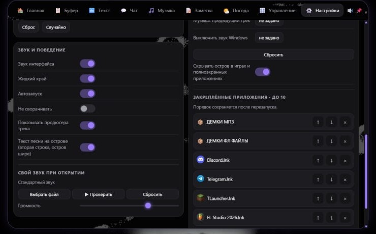 Настройки: звук, поведение, закреплённые приложения</td>
</tr>
</table>

## Установка

1. Откройте раздел [Releases](../../releases/latest) этого репозитория и скачайте установщик `Nexora_..._x64-setup.exe`.
2. Запустите его и дождитесь окончания установки. Остров появится вверху экрана.
3. Если Windows покажет предупреждение SmartScreen, нажмите **Подробнее → Выполнить в любом случае**.

Нужна Windows 10 или 11 с установленным WebView2 (на Windows 11 он есть сразу). Дальше приложение обновляется само по кнопке: **Настройки → «Обновление приложения» → «Проверить обновления»**.

## Музыка, которая всегда под рукой

Управляй Яндекс Музыкой, SoundCloud и локальными файлами прямо из острова. Переключай треки, перематывай, регулируй громкость, ставь лайки, находи тексты песен и выводи синхронные строки на остров. А ещё — обложки, информация о треках и музыкальный визуализатор.

## AI без лишних окон

Встроенный AI-чат с Qwen и моделями Claude. Улучшай и анализируй тексты, задавай вопросы, переводи с английского на русский и обратно. Используй AI для повседневных задач прямо внутри Nexora.

## Всё управление Windows в одном месте

Блокировка, сон, перезагрузка, выключение, переключение тёмной темы, быстрый доступ к Bluetooth, сворачивание всех окон и управление сетевыми инструментами. Не нужно искать нужные настройки по всему Windows.

## VPN и обход блокировок

Загрузка серверов по подписке, проверка пинга, подключение через Xray и управление инструментами обхода блокировок для Discord, YouTube, SoundCloud и Telegram. Для обхода необходимы права администратора.

## Инструменты, которыми пользуешься каждый день

- **Буфер обмена** — история текста, ссылок, кода и изображений, фильтры и закреплённые элементы.
- **Текст** — смена раскладки, транслитерация, изменение регистра, JSON, Base64 и другие преобразования.
- **Скриншоты** — захват области или всего экрана, рисование, стрелки, текст, рамки и размытие.
- **OCR и QR** — распознавание текста и сканирование QR-кодов непосредственно с экрана.
- **Заметки и таймеры** — сохраняй идеи, запускай таймеры и устанавливай напоминания.
- **Погода** — текущие условия, почасовой и дневной прогноз, ветер, влажность, осадки и другие показатели.

## Быстрый доступ ко всему необходимому

Командная строка `Alt+Space` позволяет быстро переходить между вкладками, запускать скриншоты, OCR и QR-сканер, блокировать компьютер, переводить его в сон, управлять музыкой, сворачивать окна и искать по истории буфера обмена.

На главной также доступны поиск в интернете, закреплённые приложения (до 10), системная громкость, мониторинг процессора и оперативной памяти, а также список приложений с активными сетевыми соединениями.

## Настрой под себя

Размеры, цвета, фон и GIF, сезонные темы, персонажи, анимации, звуки, горячие клавиши и поведение острова — настрой Nexora под собственный стиль. Остров можно закрепить или настроить на автоматическое скрытие в играх и полноэкранных приложениях.

---

Nexora — меньше лишних окон. Больше возможностей прямо на рабочем столе.
